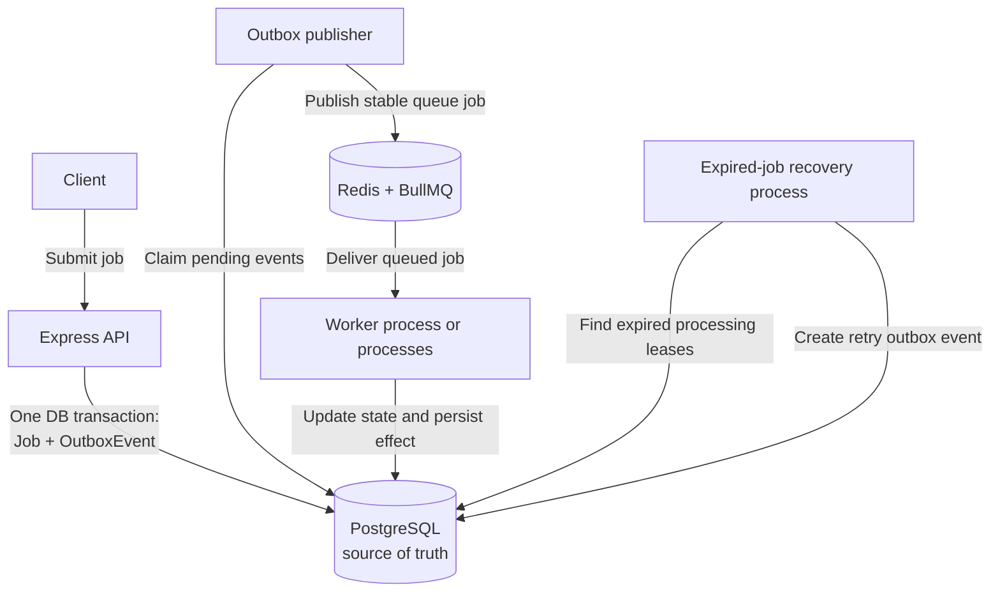
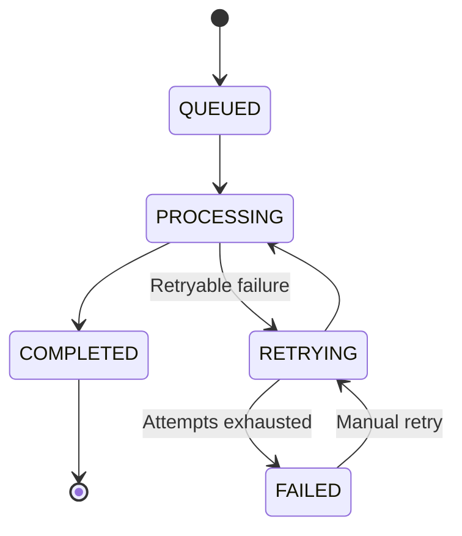

# Distributed Job Processor — Architecture and Project Decision Record

> **Document type:** Consolidated project decision record  
> **Status:** Implemented design, with final documentation and publication work in progress  
> **Last reconstructed:** 31 October 2026  
> **Scope:** Decisions made during the design, implementation, testing, and finalization of the Distributed Job Processor project.

---

## 1. Purpose of this document

This document records the reasoning and evolution of the Distributed Job Processor. It is intended to explain not only _what_ was built, but also:

- what problem the project was intended to solve;
- what alternatives were available or discussed;
- why the selected design was appropriate;
- how the implementation changed as reliability problems were discovered;
- which failure scenarios were tested;
- which trade-offs and limitations remain; and
- which ideas were deliberately deferred rather than implemented.

This is a consolidated history reconstructed from the project discussions, implementation details, test results, and configuration shared during development. It is not a claim that every alternative below was formally benchmarked. Where a trade-off is a design rationale rather than a recorded head-to-head experiment, it is described as such.

The implementation details in this document reflect the latest project state shared during the conversations. Before changing the code, use the source code and Prisma schema in the repository as the final authority if a later implementation has changed.

## 2. Original problem and motivation

The project began as a backend/distributed-systems engineering exercise: build a job-processing service that accepts work through an HTTP API, persists it reliably, and executes it asynchronously outside the request-response lifecycle.

A simple implementation could accept an HTTP request and immediately push a message to Redis. That would demonstrate a queue integration, but it would leave important production problems unresolved:

1. What if the API writes a job to PostgreSQL but fails before publishing the corresponding queue message?
2. What if the API publishes to the queue but the database transaction fails?
3. What if a publisher crashes after publishing a message but before recording that it was published?
4. What if two publisher processes attempt to claim the same pending event?
5. What if a worker crashes after claiming a job?
6. What if a job is delivered or executed more than once?
7. What if a job fails repeatedly and exhausts its retry attempts?
8. What if a client retries a manual-retry request at the same time as another client?
9. How can the system recover abandoned work without requiring an operator to edit database rows manually?
10. How can each process shut down without unnecessarily abandoning in-flight work?

The project therefore evolved from a basic asynchronous job queue into a reliability-focused distributed job processor.

### 2.1 Main goals

- Accept job submissions over HTTP.
- Persist job state in PostgreSQL.
- Publish work to a Redis-backed BullMQ queue.
- Run API, publisher, recovery, and worker responsibilities as separate processes.
- Handle transient job failures with retries and exponential backoff.
- Protect job effects against duplicate delivery using database-backed idempotency.
- Recover jobs and outbox events abandoned by crashed processes.
- Make ownership changes explicit through claim tokens, attempt identifiers, and leases.
- Test important failure windows and concurrent operations.
- Keep the implementation understandable enough to explain and defend in a backend engineering interview.

### 2.2 Non-goals for the initial project scope

The project was not intended to become a complete managed queue platform. The following were deliberately not made prerequisites for completion:

- Kubernetes deployment;
- a complex autoscaling control plane;
- a dedicated microservice for every component;
- a custom queue implementation replacing BullMQ;
- a claim of exactly-once execution;
- exhaustive maximum-throughput optimization; or
- a large observability platform before the core correctness model was complete.

The priority was correctness and explainable reliability before additional infrastructure or performance work.

---

## 3. High-level architecture decision

### Decision

Use a PostgreSQL-backed job model, a transactional outbox, a Redis/BullMQ delivery queue, and independently running API, outbox publisher, worker, and recovery processes.

### Resulting architecture



### Why this structure

The design separates three different responsibilities:

- **Durable business state:** PostgreSQL records whether a job exists, its lifecycle state, attempt ownership, and any recorded effect.
- **Message delivery and scheduling:** Redis/BullMQ transports work to workers and provides queue-level retry/backoff behaviour.
- **Execution and recovery:** workers perform jobs; the recovery process identifies work abandoned by failed workers; the publisher repairs the database-to-queue hand-off.

The separation reduces coupling. The API does not need to execute background work or wait for the worker to finish. The publisher and recovery process can be restarted independently. Worker processes can consume from the queue without placing execution responsibility inside the HTTP server.

### Trade-off

There are more processes and more lifecycle states to operate than in a single-process application. That complexity is intentional: the project is demonstrating how those boundaries are made reliable.

---

## 4. Technology selection decisions

## 4.1 Node.js and TypeScript

**Problem:** The project needed an implementation platform suitable for an HTTP API, asynchronous I/O, queue consumers, and a strongly typed codebase.

**Selected:** Node.js with TypeScript.

**Rationale:**

- Node.js provides an event-driven runtime suited to HTTP, Redis, and database I/O.
- TypeScript makes job payload handling, function contracts, and state transitions easier to reason about.
- The ecosystem provides mature libraries for Express, Prisma, PostgreSQL, Redis, BullMQ, and testing.
- Using one language across the API, publisher, recovery process, and worker reduces context switching and keeps shared types available.

**Trade-off:** TypeScript types do not validate untrusted HTTP input at runtime. Request validation is therefore handled with Zod rather than relying on compile-time types alone.

## 4.2 Express for the HTTP API

**Selected:** Express 5.

**Role:** Expose job submission, job lookup, manual retry, and health routes.

**Rationale:** Express is a small, familiar HTTP layer. The project does not need a large application framework to demonstrate the distributed processing design. Keeping the API thin makes the important transaction and lifecycle decisions visible in route/service code.

## 4.3 PostgreSQL as the durable source of truth

**Selected:** PostgreSQL.

**Problem:** Job state, retry state, ownership, idempotency records, effects, and outbox events need durable storage and transactional updates.

**Rationale:**

- Transactions allow the job and its outbox event to be committed atomically.
- Unique constraints protect idempotency keys.
- Conditional updates can implement compare-and-set ownership transitions.
- Row locks and `FOR UPDATE SKIP LOCKED` support concurrent event claiming.
- PostgreSQL can coordinate multiple application processes without relying on in-memory locks.

**Alternatives considered conceptually:** Store all state only in Redis/BullMQ, or use PostgreSQL only as a secondary record. The project instead uses PostgreSQL for authoritative application state because job creation, effects, and outbox publication state need transactional consistency.

**Trade-off:** The database is central to correctness and can become a throughput bottleneck. Connection pooling, query efficiency, transaction duration, and database availability therefore matter.

## 4.4 Prisma for database access

**Selected:** Prisma 7 with the PostgreSQL adapter (`@prisma/adapter-pg`) and the `pg` driver.

**Rationale:**

- The schema is explicit and versioned.
- Generated types reduce mistakes when accessing models and enums.
- Prisma transactions make multi-record state changes easier to express.
- Raw SQL remains available for the outbox claiming query, where PostgreSQL locking semantics are important.

**Important implementation choice:** Prisma was not forced to express every operation through its high-level API. The outbox claim uses parameterized raw SQL because `FOR UPDATE SKIP LOCKED` and the claim/update operation are central to correctness.

**Trade-off:** Generated-client configuration and the Prisma 7 adapter setup add initial configuration complexity. The project also needs to keep migrations and the generated client aligned.

## 4.5 Redis and BullMQ for queue delivery

**Selected:** Redis 7 with BullMQ 6.

**Problem:** Workers need a queue that supports asynchronous consumption, retry scheduling, and independent worker processes.

**Rationale:** BullMQ supplies queue lifecycle and retry capabilities without requiring the project to implement its own message broker. Redis provides the backing data structures and persistence configuration for the local environment.

**Alternatives considered conceptually:** Implement a queue directly using PostgreSQL polling, or operate a separate broker such as RabbitMQ. BullMQ was selected to keep the project focused on job-processing correctness while still exercising real queue/worker behaviour.

**Trade-off:** PostgreSQL and Redis have different roles and failure modes. The system must explicitly handle the boundary between them. BullMQ does not make the database-to-queue dual write atomic; that is why the transactional outbox exists.

## 4.6 Vitest and Supertest

**Selected:** Vitest for the test runner and Supertest for HTTP integration tests.

**Rationale:** The project needs both focused unit tests and integration tests that exercise Express routes and the real database/queue interactions. Vitest supports the TypeScript project setup, and Supertest allows HTTP behaviour to be tested without requiring a separate external client.

---

## 5. Decision: PostgreSQL is authoritative; BullMQ is the delivery mechanism

### Problem

A queue is good at delivering work, but the application needs a durable business record of a job and its state. Treating queue state as the only record would make application queries, manual retry rules, idempotency, and recovery harder to reason about.

### Decision

Keep job lifecycle state in PostgreSQL. Use BullMQ to deliver and schedule execution, not as the sole source of truth for the application's job record.

### Consequences

- A job can be queried through the API using its database ID.
- Attempt ownership and processing leases are stored durably.
- Retry and recovery transitions can be performed atomically with database writes.
- BullMQ job state and PostgreSQL job state must be kept coordinated by application logic.
- Queue publication success means an event has been accepted into the queue; it does **not** mean the business job has completed.

---

## 6. Decision: use the Transactional Outbox Pattern

### 6.1 The original dual-write problem

When an API accepts a job, two separate systems need to be updated:

1. PostgreSQL must persist the job.
2. Redis/BullMQ must receive a message so a worker can process it.

A direct implementation might do:

```ts
const job = await prisma.job.create({ data: ... });
await jobQueue.add("JOB_CREATED", { jobId: job.id });
```

This leaves a dangerous failure window:

- If the database write succeeds and queue publication fails, the job exists but no worker receives it.
- If queue publication happens first and the database write fails, a worker can receive a message for a job that was not durably created.
- A process crash can occur between the two operations.

A normal PostgreSQL transaction cannot atomically commit a Redis queue write. The project therefore needed a way to make the database-side intent durable before attempting queue publication.

### 6.2 Options and why the outbox was selected

| Option                                                                                  | Benefit                                                   | Problem or trade-off                                                                            |
| --------------------------------------------------------------------------------------- | --------------------------------------------------------- | ----------------------------------------------------------------------------------------------- |
| Write to PostgreSQL, then publish directly to BullMQ                                    | Simple and low code volume                                | A crash between writes can leave a job that is never queued                                     |
| Publish to BullMQ, then write PostgreSQL                                                | Queue can receive work immediately                        | Can publish a message for a database record that fails to commit                                |
| Use a distributed transaction across database and queue                                 | Could coordinate both systems in theory                   | Adds substantial coordination and operational complexity; not the approach used by this project |
| Persist an outbox event in the same PostgreSQL transaction, then publish asynchronously | The intent to publish is durable and commits with the job | Requires a publisher, event lifecycle, retries, and duplicate-safe consumption                  |

**Selected:** Transactional Outbox Pattern.

### 6.3 Implemented transaction

The job submission route creates the `Job` and corresponding `OutBoxEvent` inside the same Prisma `$transaction`.

The transaction guarantees that either:

- both records commit; or
- neither record commits.

A separate publisher later reads pending outbox events and sends them to BullMQ.

### 6.4 Why this is the right fit

The outbox does not make PostgreSQL and Redis one atomic system. Instead, it removes the dangerous dual write from the request path:

- the API atomically stores the job and the intent to publish;
- the publisher can retry delivery after a crash or temporary Redis failure;
- a process restart does not lose the record of work waiting to be published.

### 6.5 Consequences

- Job creation does not depend on Redis being available at the exact moment of the HTTP request, provided PostgreSQL is available.
- Outbox events need their own status, claim ownership, lease, error, and publication timestamp.
- Delivery is at least once, so duplicate handling is required.
- The publisher becomes a first-class runtime process that must be monitored and shut down correctly.

---

## 7. Decision: model job and outbox state explicitly

### 7.1 Job states

The `JobStatus` enum includes:

- `QUEUED`
- `PROCESSING`
- `RETRYING`
- `COMPLETED`
- `FAILED`

The intended lifecycle is:



`PROCESSING` represents an active worker attempt. `RETRYING` indicates the job is eligible for another attempt. `FAILED` indicates that automatic attempts have been exhausted and the job requires explicit manual retry or other operator action. `COMPLETED` is the terminal successful state.

### 7.2 Why store attempt ownership on the job

The `Job` model includes:

- `attempts` and `maxAttempts`;
- `currentAttemptId`;
- `processingLeaseExpiresAt`;
- `lastError`;
- creation and update timestamps.

The attempt ID identifies the worker attempt currently owning the job. It is used in conditional updates so an old or delayed worker cannot overwrite the state written by a newer attempt.

The processing lease indicates when a job's current ownership should be considered expired if the worker stops renewing it.

### 7.3 Outbox states and metadata

The `OutBoxEvent` model includes a status (including `PENDING` and `PUBLISHED`), publisher-attempt count, `lastError`, `publishedAt`, `claimToken`, and `claimedUntil`.

These fields separate event-delivery lifecycle from job-execution lifecycle. An outbox event can be `PUBLISHED` while its associated job is still `QUEUED` or `PROCESSING`.

### 7.4 Why not collapse everything into one status

Publishing an event and completing a job are different events owned by different processes. Separate records and state transitions make it possible to see whether a job is waiting for publication, waiting in the queue, being processed, or has completed.

---

## 8. Decision: separate the API, publisher, worker, and recovery runtime

### Decision

Run the application as independently started processes:

- API: `npm run dev` (development) or `npm start` (compiled runtime);
- worker: `npm run worker`;
- outbox publisher: `npm run outbox:publish`;
- expired-job recovery: `npm run recovery`.

### Why separate them

- HTTP request handling should not be tied to the time required to execute a job.
- Publisher failures should not crash the API process.
- Worker capacity can be increased independently of API capacity.
- Recovery can continue to inspect and repair abandoned work independently.
- Each process has a clear lifecycle and shutdown responsibility.

### Alternatives

A single process could host the Express API, publisher loop, recovery loop, and BullMQ worker. That is simpler for a demo, but it couples their resource usage and failure lifecycles. Separate processes were chosen to reflect a more realistic distributed service and to make the boundaries testable.

### Trade-off

Local development requires multiple terminals or a process manager. All processes also need consistent environment configuration and access to the same PostgreSQL and Redis instances.

---

## 9. Decision: safely claim outbox events with PostgreSQL locking, claim tokens, and leases

### 9.1 Problem

A publisher must select pending events and mark them as claimed. If two publishers read the same pending rows before either updates them, both could publish the same event. A process can also crash after claiming rows, leaving them unavailable unless the claim expires.

### 9.2 Selected approach

`claimPendingEvents()` uses a PostgreSQL transaction and a parameterized raw SQL statement built around a CTE:

1. Select rows with `PENDING` status.
2. Include rows with no `claimedUntil` value or an expired lease.
3. Order candidates by `createdAt`.
4. Limit the claim batch.
5. Use `FOR UPDATE SKIP LOCKED` to avoid waiting on rows another publisher has locked.
6. Update the selected events with a new UUID claim token and lease expiry.
7. Return the claimed event identifiers and payload data.

The recorded configuration is:

| Setting                 |          Value | Purpose                                         |
| ----------------------- | -------------: | ----------------------------------------------- |
| Outbox claim batch size |             10 | Bound the number of events claimed in one query |
| Outbox lease duration   |     30 seconds | Allow abandoned claims to become eligible again |
| Claim token             | `randomUUID()` | Identify the owner of a particular claim        |

The claim transaction also has explicit Prisma `maxWait` and `timeout` values (10 seconds and 15 seconds respectively in the implementation shared during development).

### 9.3 Why `FOR UPDATE SKIP LOCKED`

A normal row lock can make another publisher wait for the first publisher to finish. `SKIP LOCKED` lets competing publishers skip rows already claimed by another transaction and continue with other eligible rows. This supports concurrent publisher processes without requiring a single global application lock.

### 9.4 Why a claim token as well as a lease

A lease answers: _when may another process attempt to take over this work?_

A claim token answers: _does this process still own the specific claim it is trying to update?_

The publisher only marks an event `PUBLISHED` or records an error if its conditional update still matches the event's current claim token. If another publisher has reclaimed the event, the old publisher's update affects zero rows and cannot overwrite the newer ownership state.

### 9.5 Trade-offs and limitations

- The lease must be long enough for the expected publishing operation, or renewed if long-running work is introduced.
- A lease can expire while a slow publisher is still active. Claim-token checks prevent stale database updates, while stable queue IDs help contain duplicate queue publication.
- The database clock is used by the SQL lease calculation, avoiding dependence on each publisher host having precisely synchronized application clocks for the claim comparison.

---

## 10. Decision: publish outbox events with stable, event-specific BullMQ job IDs

### Problem

The publisher can crash after `jobQueue.add()` succeeds but before the outbox row is updated to `PUBLISHED`. When the lease expires, another publisher must retry the event. Without a stable queue identifier, this retry could create a second queue job.

### Decision

Use the outbox event ID to construct the BullMQ job ID:

```ts
jobId: `outbox-${event.id}`;
```

The publisher also passes the event type and payload, plus the associated job's `maxAttempts`.

### Why the outbox event ID rather than the business job ID

An initial approach used the business `jobId` as the BullMQ job ID. That created a retry problem: failed BullMQ jobs are retained (`removeOnFail: false`), so a later manual retry using the same queue ID could be blocked by the retained failed queue job.

The implementation therefore changed to an ID derived from the **outbox event ID**:

- a duplicate publication attempt for the same outbox event uses the same BullMQ job ID;
- a manual retry creates a new outbox event, which has a new event ID and therefore a new BullMQ job ID;
- the business `Job` record retains the same business identity across attempts.

This separates the identity of a business job from the identity of a queue-delivery event.

### Queue options recorded in the implementation

The publisher supplies:

- `attempts: event.job.maxAttempts`;
- exponential backoff with an initial delay of 1,000 ms;
- `removeOnComplete: 1000`;
- `removeOnFail: false`.

### Important limitation

BullMQ job-ID deduplication is useful while the original queue job record is retained. It is not a universal exactly-once guarantee. If queue records are eventually removed, another publication can create a new queue entry. Database-backed idempotency remains necessary to protect business effects.

---

## 11. Decision: make outbox publication conditional and recoverable

### Success path

After `jobQueue.add()` resolves, the publisher performs a conditional update requiring:

- the matching outbox event ID;
- `PENDING` status; and
- the same claim token.

On success it:

- changes status to `PUBLISHED`;
- sets `publishedAt`;
- clears `lastError`;
- clears `claimToken`; and
- clears `claimedUntil`.

If the update count is not one, the publisher logs a warning that the event was enqueued but its claim is no longer owned by this publisher. This avoids blindly overwriting a newer claim.

### Failure path

If queue publication or the subsequent operation throws, the publisher:

- records the error message in `lastError`;
- increments the outbox event's `attempts` counter;
- clears the claim token and lease so that the event can be attempted again; and
- logs a failure.

The event remains pending for later recovery rather than being silently discarded.

### Why not mark a failed publication as permanently failed immediately

A Redis outage or transient connection failure should not permanently lose the event. Keeping it eligible for a later attempt makes the publisher recoverable. This project does not currently define a separate terminal outbox dead-letter state or a maximum publisher-attempt policy; that remains an operational policy decision for a future extension.

---

## 12. Decision: run the outbox publisher continuously

### Initial implementation

The first publisher runner was a one-shot script: call `publishPendingOutboxEvents()`, disconnect Prisma, and exit.

### Problem discovered

If that script ran once and failed, pending events would remain pending until an operator or another scheduled invocation ran it again. That did not provide the continuous recovery behaviour expected from a long-running service.

### Decision

Change the runner into a continuous polling process.

The implementation shared during development has these behaviours:

- poll interval: 3,000 ms;
- run the first publishing cycle immediately rather than waiting for the first interval;
- use `isRunning` to prevent overlapping cycles in the same process;
- use `isShuttingDown` to prevent new cycles during shutdown;
- catch and log cycle-level errors so a temporary failure does not terminate the process; and
- clear the timer and wait for an in-flight cycle before disconnecting Prisma during graceful shutdown.

### Why polling

Polling is straightforward, easy to restart, and sufficient for the project's initial scope. The durable outbox makes the poller's restart safe: pending work remains represented in PostgreSQL.

### Trade-off

Polling introduces a small delay between an event becoming pending and the next cycle. It also creates periodic database queries when the queue is empty. The 3-second interval was selected as a simple initial operating setting, not as a value proven optimal by a completed throughput study.

---

## 13. Decision: process claimed outbox events with bounded concurrency

### Initial approach

The publisher originally used a sequential loop. Each event was added to BullMQ and then updated in PostgreSQL before the next event was processed.

### Problem

Sequential `await` operations limit throughput because the next event waits for both the queue operation and database update of the previous event, even though events in the same claim batch are independent.

### Change made

A bounded-concurrency approach was introduced using groups of events and `Promise.all()`:

- `PUBLISH_CONCURRENCY` is set to 10;
- the claimed events are sliced into groups of at most 10;
- each group is processed concurrently;
- each event retains its own `try/catch` and conditional database update.

The claim batch size was returned to 10 rather than keeping an earlier experimental value of 50. The lease remained 30 seconds.

### Why bounded concurrency instead of unbounded `Promise.all`

Launching every claimed event at once could create an unnecessarily large burst of concurrent Redis and PostgreSQL operations. Bounded concurrency makes the limit explicit and gives the system room to apply backpressure.

### Why the proposed batch-draining loop was not implemented

A later optimization proposal was to repeatedly claim batches inside one publisher cycle until no pending events remained. Before making that change, the project chose to stop pursuing further load-test optimization and return to final reliability and documentation work. Therefore, do not assume the proposed batch-draining loop is part of the implementation unless it has subsequently been added in the repository.

---

## 14. Decision: use atomic worker attempt ownership

### Problem

Multiple workers can receive work around the same time, and a message can be redelivered. The system needs one authoritative record of which attempt currently owns a job.

### Decision

`startJobAttempt()` uses a conditional database update (`updateMany`) to claim a job only when it is in an eligible state (`QUEUED` or `RETRYING`) and has no current attempt owner.

On a successful claim it:

- changes the state to `PROCESSING`;
- increments the attempt count;
- writes a new `currentAttemptId`; and
- sets `processingLeaseExpiresAt`.

The recorded processing lease is 60 seconds in the implementation shared during development.

### Why a database compare-and-set update

A read followed by an unconditional update is unsafe: two workers can both read the same state before either writes. A conditional update makes the state transition atomic at the database boundary. Only the process whose update affects the row has acquired the attempt.

### Stale attempt protection

Worker completion and failure updates are conditional on the current attempt identifier and expected processing state. If an old attempt resumes after a newer attempt has taken ownership, it cannot overwrite the newer attempt's state.

---

## 15. Decision: add worker heartbeats and processing leases

### Problem

A worker can crash, lose its connection, or stop making progress after claiming a job. Without a lease, the job could remain `PROCESSING` indefinitely.

### Decision

Use a processing lease stored in PostgreSQL and renew it periodically while a job is executing.

Recorded settings:

| Setting                      |      Value |
| ---------------------------- | ---------: |
| Processing lease duration    | 60 seconds |
| Heartbeat / renewal interval | 20 seconds |

The renewal operation is conditional on the matching job, current attempt ID, and expected processing state. This ensures that a stale worker cannot renew a lease after ownership has changed.

### Why a lease plus heartbeat

- The lease gives the recovery process a durable expiration boundary.
- The heartbeat distinguishes a live, progressing worker from an abandoned attempt.
- The renewal interval is shorter than the lease duration, leaving time for transient delays.
- Ownership checks protect against a delayed heartbeat from an old attempt.

### Trade-off

A lease is a failure-detection mechanism, not proof that a process is permanently dead. Pauses, overloaded hosts, or database connectivity issues can delay renewals. The lease duration and renewal interval therefore need to be chosen with execution time and infrastructure characteristics in mind.

---

## 16. Decision: make job effects idempotent in PostgreSQL

### Problem

At-least-once delivery means the same logical job may be delivered more than once. A worker can also complete a side effect and crash before the queue or database state fully reflects completion. A retry may then execute the handler again.

### Decision

Use a database-backed idempotency key and a unique constraint to protect the business effect. The implementation records the effect and idempotency information transactionally. The project uses a stable key shaped like:

```text
job:<jobId>
```

The `JobEffect` record has a unique `idempotencyKey`, and idempotency-related records are stored in PostgreSQL. The effect and corresponding record are written in the same transaction. Duplicate-key (`P2002`) handling treats an already-created effect as an idempotent duplicate rather than applying it again.

### Why the database enforces uniqueness

An in-memory map or process-local lock would not coordinate multiple worker processes and would disappear on restart. A PostgreSQL unique constraint provides a shared, durable enforcement point.

### Why the effect and idempotency record share a transaction

If the effect commits but the idempotency record does not, a retry could apply the effect again. If the record commits but the effect does not, a retry could incorrectly believe the effect already happened. A transaction makes those writes succeed or fail together.

### Guarantee and boundary

This design protects the database-backed effect represented by the transaction. It does not magically make arbitrary external side effects (for example, sending an email through a third-party provider) exactly once. External systems need their own idempotency support or a corresponding outbox/integration strategy.

---

## 17. Decision: use BullMQ retries with exponential backoff and persist job failure state

### Decision

The publisher configures each BullMQ job with the associated job's `maxAttempts` and exponential backoff starting at 1,000 ms.

The PostgreSQL job record separately tracks `attempts`, `maxAttempts`, `status`, and `lastError`.

The worker's failure path conditionally updates the database for the current attempt. Depending on whether attempts remain, the job is moved to `RETRYING` or `FAILED`; attempt ownership and the processing lease are cleared. The error is recorded in `lastError`.

### Why exponential backoff

Immediate retries can repeatedly hit an unavailable dependency and create a tight failure loop. Exponential backoff spaces retries out and reduces pressure during transient outages.

### Retaining failed BullMQ records

The publisher uses `removeOnFail: false`, retaining failed BullMQ job records. This supports inspection and was also relevant to the stable-ID decision: a retained failed queue job with the business job ID could block a manual retry. Using an event-specific queue ID avoids reusing the same queue ID for a new manual-retry event.

### Dead-letter terminology

The project records exhausted job failures in PostgreSQL as `FAILED` and retains failed BullMQ job records. It does not currently implement a separate, independently operated dead-letter queue with its own consumer and retention policy. Documentation should describe the actual failed-job handling rather than claim a dedicated DLQ that does not exist.

---

## 18. Decision: recover expired jobs in a separate runtime

### Problem

A worker may claim a job and then crash before completing it. The queue may redeliver a message, but the PostgreSQL job record can remain in `PROCESSING` with an expired lease. The application needs a durable repair process.

### Decision

Add `recoverExpiredJobs()` and run it continuously through a dedicated recovery process.

The implementation shared during development:

- checks for jobs still in `PROCESSING` whose processing lease has expired;
- requires a current attempt identifier so it is recovering an actual claimed attempt;
- claims a bounded set (10) of candidates;
- uses PostgreSQL transaction/locking and conditional updates;
- moves eligible jobs back to `RETRYING`;
- clears stale attempt ownership and lease data; and
- creates a new outbox event in the same transaction so the job can be published again.

The recovery runner polls every 10 seconds and has graceful-shutdown handling. The recovery transaction was configured with a 10-second `maxWait` and a 15-second timeout in the implementation shared during development.

### Why use an outbox event for recovery

Recovery must not directly make an uncoordinated queue write while changing PostgreSQL state. Creating a new outbox event in the same transaction preserves the same database-to-queue reliability boundary used for original job submissions.

### Why a separate recovery process

Recovery is operationally different from normal job execution. Separating it allows it to be restarted and tuned independently and prevents ordinary request handling from owning recovery work.

---

## 19. Decision: support manual retry through a conditional API transition

### Problem

A job that has exhausted automatic retries needs a controlled way to be attempted again. Two clients might also submit a manual retry request concurrently.

### Decision

Implement:

```http
POST /jobs/:id/retry
```

The route performs the following logic within a database transaction:

1. Find the job; return `404` if it does not exist.
2. Require `FAILED` status; otherwise return a conflict response (`409`).
3. Conditionally update the job using `updateMany` with `status: FAILED` in the `where` clause.
4. Reset the retry attempt counter for the new manual retry cycle and clear the old `lastError`.
5. Move the job to `RETRYING`.
6. Create a new `JOB_CREATED` outbox event in the same transaction.
7. Return an accepted response (`202`) when the retry transition succeeds.

### Why conditional update instead of read-then-write

Two requests can both read `FAILED`. If they then both update unconditionally, they could create two new outbox events. The conditional update makes the state transition a compare-and-set operation. Only one request can change the row from `FAILED`; the competing request observes that it no longer matches and does not create another retry event.

### Why create a new outbox event

A manual retry is a new queue-delivery event for the same business job. A new outbox event gives it a new event-specific BullMQ job ID, avoiding conflict with a retained failed queue job from an earlier attempt.

### Test coverage

The project added a concurrent manual-retry integration test to verify that only one request wins and only one new outbox event is created, as well as an end-to-end manual retry test.

---

## 20. Decision: clear stale error data when a new attempt succeeds or begins

### Problem

A previous failed attempt can leave `lastError` populated even after a later retry has been accepted or successfully completed. That makes the current job state misleading.

### Decision

Clear `lastError` at appropriate successful state transitions:

- manual retry clears the old error when resetting the failed job;
- successful job completion clears the prior error;
- successful outbox publication clears the previous publication error.

### Rationale

`lastError` should represent the current unresolved failure context, not a stale message from an earlier attempt that has since recovered. Historical error tracking would require a separate attempt/event history model rather than overloading the current-state field.

---

## 21. Decision: share graceful-shutdown behaviour

### Problem

Long-running processes need to stop on `SIGINT` or `SIGTERM`. Abrupt termination can interrupt a publisher cycle, worker execution, or recovery pass and can leave connections open.

### Decision

Introduce a shared `createGracefulShutdown()` helper under `src/worker/graceful-shutdown.ts`, configured with process-specific operations:

- stop accepting or starting additional work;
- allow relevant in-flight work to finish or close safely; and
- disconnect the Prisma database client.

The worker, publisher, and recovery runtime use the shared shutdown mechanism with their own `stopProcessing` behaviour.

The continuous publisher specifically sets its shutdown flag, clears its interval, waits while a publishing cycle is in progress, and then disconnects Prisma.

### Why a shared helper

Signal handling and the high-level shutdown sequence should not be copied with subtly different behaviour into each process. The shared helper keeps the common contract consistent while allowing each process to define how it stops its own work.

### Trade-off

Graceful shutdown cannot guarantee that every external operation succeeds. If a process is killed forcefully or exceeds the platform's shutdown deadline, durable leases and recovery logic remain necessary.

---

## 22. Decision: run local PostgreSQL and Redis with Docker Compose

### Initial development setup

The project initially used a hosted Neon PostgreSQL database during development and explored performance against that remote database.

### Problem discovered

The hosted database was in AWS US East (Ohio), while development and benchmark execution were in India. The round-trip delay materially affected measured request latency. A simple database query also showed high latency, so that result was not a useful representation of local application/database performance.

### Decision

Add local development infrastructure using Docker Compose:

- PostgreSQL 17;
- Redis 7;
- named Docker volumes for persistent data;
- PostgreSQL health check using `pg_isready`;
- Redis started with append-only persistence enabled (`--appendonly yes`).

The local database uses a development-only connection configuration. Actual credentials belong in `.env`, not source control.

### Why this approach

- The same local infrastructure can be started consistently.
- Local API/database measurements avoid transcontinental network latency.
- PostgreSQL and Redis state can persist across container restarts using volumes.
- Developers do not need to install and configure both services directly on Windows.

### Migration decision

The existing Prisma migrations were applied to the local PostgreSQL database using `prisma migrate deploy`. The migration history was preserved rather than replacing the schema with an ad hoc database-only setup.

### Trade-off

Local performance is not the same as production performance. A local benchmark excludes many network, hosting, storage, and operational effects that matter in deployment. Results must always state the environment in which they were collected.

---

## 23. Decision: protect shared integration-test infrastructure from application processes

### Issue discovered

Integration tests use the same local PostgreSQL database and Redis/BullMQ queue as the application. When the standalone worker was left running during a test run, it could consume a queue item created by a test. In one outbox crash-window test, the worker locked the BullMQ job before the test cleanup attempted to remove it.

This caused cleanup failures and made the test behaviour depend on whether an application worker was running concurrently.

### Decision / operating rule

Stop the API, worker, publisher, and recovery processes before running the integration test suite against the shared local infrastructure. Keep PostgreSQL and Redis containers running.

### Why

The tests and application were competing consumers of the same queue. Stopping the application processes removes that uncontrolled interaction and makes the test result reproducible.

### Future improvement

A stronger long-term test architecture could provision isolated database and Redis namespaces/instances for tests, or use per-test queue names. That would allow tests to run while development services are active. This isolation was not required for the current project scope.

---

## 24. Decision: test failure windows and concurrency, not only happy-path API responses

### Testing objective

The test strategy expanded beyond route-level correctness to verify the reliability mechanisms that justify the architecture.

### Test areas implemented

- health endpoint behaviour;
- job route behaviour;
- outbox event claiming;
- BullMQ job deduplication;
- idempotency;
- worker handler behaviour;
- job failure and retry lifecycle;
- worker shutdown;
- outbox lease reclamation;
- worker lease renewal;
- expired-job recovery;
- concurrent manual retry.

### Key reliability tests

#### Stale publisher ownership

Verify that a publisher holding an old claim cannot overwrite a newer publisher's claim. This validates the conditional claim-token update.

#### Publisher crash window

Simulate the condition where the publisher successfully adds the event to BullMQ but does not mark the outbox event as published. After the lease can be reclaimed, publication is retried with the same event-specific BullMQ job ID. The test validates the duplicate-prevention behaviour while the original queue job remains retained.

#### Concurrent manual retry

Issue concurrent manual retry requests for a failed job. The conditional status update ensures only one request wins and creates one new outbox event.

#### Expired worker attempt

Verify that an expired processing lease is recovered, the old attempt is cleared, and a new outbox event is created for another attempt.

#### Lease renewal and worker ownership

Verify that valid workers can renew their leases and that stale attempts cannot update the state belonging to a newer attempt.

### Recorded test suite

At the point the suite was summarized during development, it contained approximately 15 test files and 44 tests. The last reported full verification passed. Test names shared during development included:

- `health.test.ts`
- `health-check.test.ts`
- `job.test.ts`
- `outbox-claim.test.ts`
- `bullmq-dedup.test.ts`
- `idempotency.test.ts`
- `worker-idempotency.test.ts`
- `worker-handler.test.ts`
- `job-failure.test.ts`
- `bullmq-retry-lifecycle.test.ts`
- `worker-shutdown.test.ts`
- `outbox-lease-reclaim.test.ts`
- `worker-lease-renewal.test.ts`
- `worker-expired-job-recovery.test.ts`
- `graceful-shutdown.test.ts`

The exact test count can change as tests are added or removed; the current Vitest output is the source of truth.

### Final verification decision

The final verification stage was run with all application processes stopped and local infrastructure available. The following commands were reported as passing:

```bash
npm run check
npm test
```

`npm run check` runs the TypeScript build followed by ESLint. `npm test` runs Vitest sequentially using the configured single-worker/no-file-parallelism flags.

---

## 25. Performance testing: what was tried and what was deliberately deferred

Performance testing was explored to understand API enqueue behaviour and identify whether the publisher/worker pipeline could keep up with an incoming burst. The project later decided not to make extensive throughput optimization a completion requirement.

### 25.1 Hosted database experiment

A corrected request against the hosted Neon database produced a very low observed rate and high latency. The database was hosted in US East (Ohio), while the development machine was in India. This showed that the test was strongly affected by remote network distance and was not a clean measurement of local application performance.

An earlier attempt was invalid because PowerShell quoting malformed the JSON request body. It returned no successful HTTP responses. Its apparent request rate was discarded and must not be quoted as a benchmark.

### 25.2 Valid local Autocannon baseline

With local Docker PostgreSQL and the application processes running, the valid Autocannon run used:

- 5 concurrent connections;
- 30-second duration;
- `POST /jobs`;
- a JSON job payload;
- local PostgreSQL and Redis infrastructure.

Recorded result:

| Metric                      |                           Result |
| --------------------------- | -------------------------------: |
| Requests                    |                           20,783 |
| Successful HTTP responses   | 20,783 responses with status 201 |
| Average requests per second |                           692.77 |
| Average latency             |                          6.72 ms |
| p50 latency                 |                             6 ms |
| p97.5 latency               |                            15 ms |
| p99 latency                 |                            19 ms |

**Interpretation:** this is API enqueue throughput for that local test setup. It is not worker completion throughput and must not be described as 693 jobs processed per second.

### 25.3 Later manual concurrency test

A separate Node.js script sent 1,000 requests with concurrency 50. The recorded result was:

| Metric              |              Result |
| ------------------- | ------------------: |
| Total requests      |               1,000 |
| Successful          |               1,000 |
| Failed              |                   0 |
| Duration            |        5.39 seconds |
| Observed throughput | 185.46 requests/sec |
| p50 latency         |           235.68 ms |
| p95 latency         |           396.33 ms |
| p99 latency         |           469.97 ms |

This was a different test method and workload from the Autocannon run, so the two results are not a controlled apples-to-apples comparison. The higher-concurrency test showed increased latency and lower observed request rate, but it did not by itself identify the exact bottleneck.

### 25.4 Why broader load testing was deferred

The team chose to stop spending project time on maximum-throughput optimization and focus on completing the reliability implementation and documentation. A proposed additional publisher batch-draining optimization was not made a prerequisite for completion. K6 was also not introduced; the agreed tool for the exploratory work was Autocannon.

### Performance claims allowed by the recorded evidence

A defensible statement is:

> Benchmarked the job-submission API at approximately 693 requests/sec with 6.72 ms average latency using Autocannon against local PostgreSQL (5 concurrent connections, 30 seconds).

Do **not** claim:

- 693 jobs completed per second;
- 693 worker executions per second;
- a measured maximum sustainable end-to-end throughput; or
- that the 50-concurrency manual run proves a particular database bottleneck.

A true end-to-end throughput benchmark would need to count completed jobs over a defined interval, account for the queue and worker backlog, and report the workload and environment.

---

## 26. Finalization and publication decisions

After the core reliability tests passed, the project deliberately moved into finalization instead of adding more features.

### Stage 1 — Code cleanup

The cleanup stage was marked complete. Its scope was intentionally conservative:

- remove obsolete commented-out implementations;
- remove unused imports and incomplete comments;
- confirm scripts and source layout;
- avoid refactoring working code merely for stylistic reasons.

### Stage 2 — Final verification

The final verification stage was marked complete after:

```bash
npm run check
npm test
```

Both commands were reported as passing.

### Stage 3 — GitHub publication and documentation

The remaining work is to document the project and prepare it for publication. The documentation plan includes:

- project overview and architecture;
- job lifecycle and outbox data flow;
- API endpoints;
- installation and local setup;
- environment variables;
- commands for starting each process;
- test instructions;
- reliability guarantees and limitations; and
- design decisions explaining the trade-offs.

### Repository hygiene decision

The repository uses `.gitignore` rules for `.env`, `.env.*` (while allowing `.env.example`), generated/build directories, and `redis-backup.rdb`.

The following checks were run:

```powershell
git ls-files .env redis-backup.rdb
git check-ignore -v .env redis-backup.rdb
```

`git ls-files` returned no tracked paths for those files, and `git check-ignore` confirmed that both `.env` and `redis-backup.rdb` were ignored. This is important because `.env` can contain credentials and a Redis dump can contain local application data.

The root environment template contains:

```env
DATABASE_URL=
TEST_DATABASE_URL=
REDIS_HOST=127.0.0.1
REDIS_PORT=6379
PORT=3000
```

Real connection strings and credentials belong in the developer's local `.env` or deployment secret store, not in Git.

---

## 27. Current implementation snapshot

The following is the implementation state recorded during project finalization. Re-check the repository if code has changed since this snapshot.

### 27.1 Main source layout

```text
src/
├── api/
│   ├── routes/
│   │   ├── health-check.ts
│   │   ├── health.ts
│   │   └── job.ts
│   ├── app.ts
│   └── server.ts
├── db/
│   ├── check-connection.ts
│   ├── diagnose-connection.ts
│   └── prisma.ts
├── outbox/
│   ├── claim-events.ts
│   ├── publisher.ts
│   └── run-publisher.ts
├── queue/
│   └── job-queue.ts
└── worker/
    ├── graceful-shutdown.ts
    ├── handle-job-failure.ts
    ├── handle-job.ts
    ├── index.ts
    ├── process-job.ts
    ├── recover-expired-jobs.ts
    ├── renew-processing-lease.ts
    ├── run-recovery.ts
    └── start-job-attempt.ts
```

### 27.2 Data models

The Prisma schema includes the following important models/enums:

- `Job` — durable job state and current processing attempt;
- `OutBoxEvent` — durable intent to publish a queue event;
- `IdempotencyRecord` — idempotency information;
- `JobEffect` — the database-backed effect guarded by a unique idempotency key;
- `JobStatus` — job lifecycle states; and
- `OutBoxStatus` — outbox publication states.

The project uses the Prisma model/enum naming `OutBoxEvent` and `OutBoxStatus` (capital `B` in `OutBox`) in the schema and generated client.

### 27.3 Important recorded configuration

| Area                            | Setting                                         |
| ------------------------------- | ----------------------------------------------- |
| Local PostgreSQL                | PostgreSQL 17 in Docker Compose                 |
| Local Redis                     | Redis 7 in Docker Compose                       |
| Redis persistence               | Append-only file enabled in the local container |
| Outbox claim batch              | 10 events                                       |
| Outbox claim lease              | 30 seconds                                      |
| Publisher poll interval         | 3 seconds                                       |
| Publisher per-group concurrency | 10                                              |
| Worker processing lease         | 60 seconds                                      |
| Worker lease renewal            | Every 20 seconds                                |
| Recovery poll interval          | 10 seconds                                      |
| Recovery batch                  | Up to 10 expired jobs                           |
| BullMQ retry backoff            | Exponential, starting at 1 second               |
| Default job max attempts        | 3 in the schema shared during development       |

These are implementation settings, not universal recommendations. They should be changed only with a reason and with the associated lease, timeout, concurrency, and database-capacity implications understood.

### 27.4 Important npm scripts

```json
{
  "dev": "tsx watch src/api/server.ts",
  "build": "tsc -p tsconfig.json",
  "start": "node dist/api/server.js",
  "test": "vitest run --maxWorkers=1 --no-file-parallelism",
  "test:watch": "vitest",
  "lint": "eslint .",
  "format": "prettier --write .",
  "format:check": "prettier --check .",
  "check": "npm run build && npm run lint",
  "worker": "tsx src/worker/index.ts",
  "outbox:publish": "tsx src/outbox/run-publisher.ts",
  "recovery": "tsx src/worker/run-recovery.ts",
  "test:db": "tsx src/db/check-connection.ts"
}
```

---

## 28. Guarantees, non-guarantees, and remaining limitations

### Guarantees the design is intended to provide

- A committed job submission has a corresponding committed outbox event.
- Pending outbox events remain durable and can be reclaimed after a publisher claim expires.
- A stale publisher cannot update an event using an obsolete claim token.
- The same outbox event uses a stable BullMQ job ID when publication is retried.
- Worker attempts claim jobs through conditional database updates.
- Stale worker attempts cannot overwrite state belonging to a newer attempt.
- Expired processing leases can be recovered into another retry attempt.
- Database-backed job effects are protected by a unique idempotency key and transaction.
- Manual retry is guarded so concurrent retry requests do not both create a new outbox event.

### Guarantees the design does not claim

- Exactly-once message delivery.
- Exactly-once execution of arbitrary handler code.
- Exactly-once side effects in external systems that do not support idempotency.
- A fixed maximum end-to-end jobs-per-second rate.
- Automatic horizontal scaling of worker processes.
- Zero downtime during every possible deployment or infrastructure failure.
- A dedicated dead-letter queue with a separate consumer and policy.

### Work deliberately deferred

- Exhaustive load testing and maximum-throughput tuning;
- K6-based load testing;
- publisher drain-until-empty loop;
- formal production worker autoscaling;
- Kubernetes deployment;
- distributed rate limiting;
- a complete metrics/observability stack;
- isolated per-test Redis/database infrastructure.

These items may be valuable future improvements, but they were not required to finish the agreed reliability-focused project scope.

---

## 29. Summary of the most important architectural decisions

The project can be summarized by the following decisions:

1. **PostgreSQL is the source of truth** for job and outbox state.
2. **The API writes the job and outbox event in one transaction** to avoid the database/queue dual-write problem.
3. **A separate publisher sends outbox events to BullMQ** and can recover pending events after failure.
4. **PostgreSQL row locking, `SKIP LOCKED`, claim tokens, and leases** coordinate concurrent publishers.
5. **BullMQ job IDs are derived from outbox event IDs**, so a publication retry is deduplicated while a manual retry gets a new queue identity.
6. **Workers claim attempts atomically** and use attempt identifiers to prevent stale attempts from changing current state.
7. **Processing leases and heartbeats** let a separate recovery process find and repair abandoned jobs.
8. **Database-backed idempotency** protects effects against duplicate delivery and retry.
9. **Manual retry is a conditional state transition** and creates a new outbox event transactionally.
10. **Graceful shutdown is shared across long-running processes**, while durable leases and recovery handle forced termination.
11. **Failure-window and concurrency tests** validate the reliability mechanisms instead of relying only on happy-path route tests.
12. **Performance measurements are reported narrowly and honestly**: API enqueue throughput is not worker completion throughput.

The central design principle is that distributed systems failures are expected. The system does not rely on every process staying alive or every message being delivered exactly once. Instead, durable state, conditional transitions, idempotency, leases, and recovery make repeated attempts safe and make abandoned work detectable.

---

## 30. How to maintain this decision record

When a meaningful design decision changes, update this document rather than silently rewriting history.

For a new decision, record:

1. **Context/problem** — what forced the decision?
2. **Options** — which alternatives were considered?
3. **Decision** — what was selected?
4. **Rationale** — why was it selected?
5. **Consequences** — what complexity or limitation did it introduce?
6. **Verification** — which test, benchmark, or operational observation supports it?
7. **Status** — proposed, accepted, implemented, superseded, or deferred.

If a decision is superseded, keep the old rationale and add a new entry explaining what changed and why. This file is intended to preserve the engineering reasoning behind the project, not merely describe the latest code.
